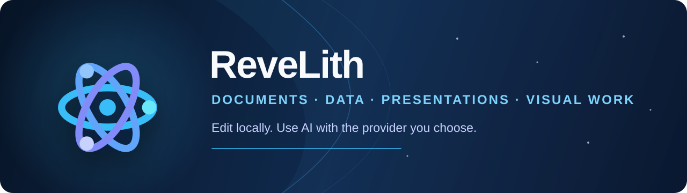
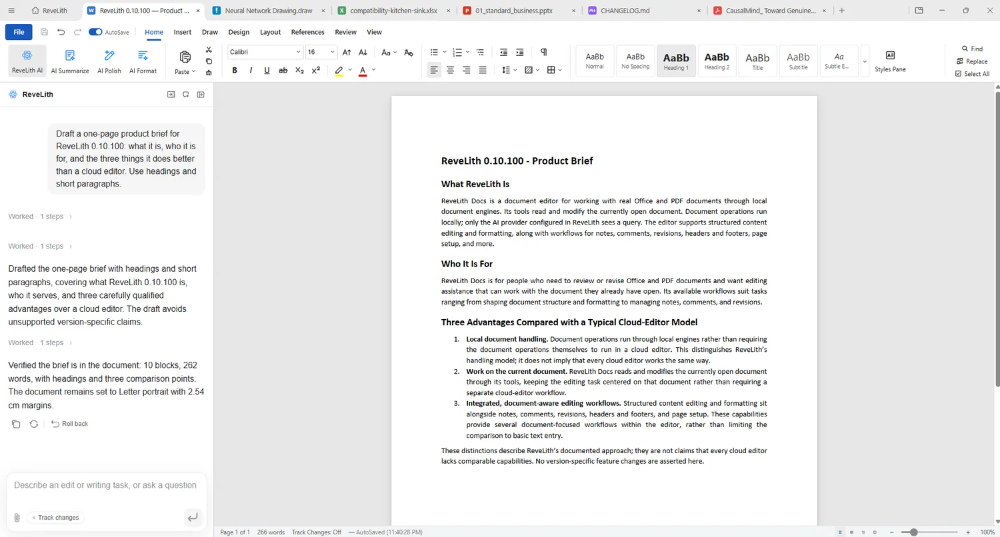
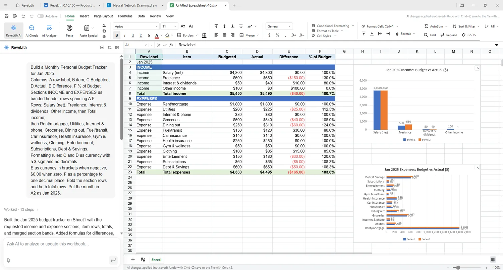
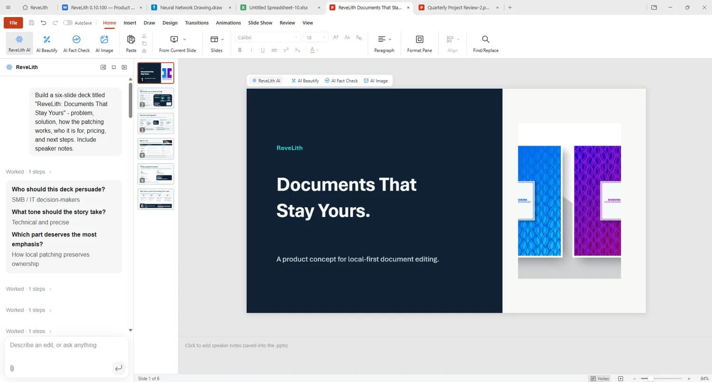
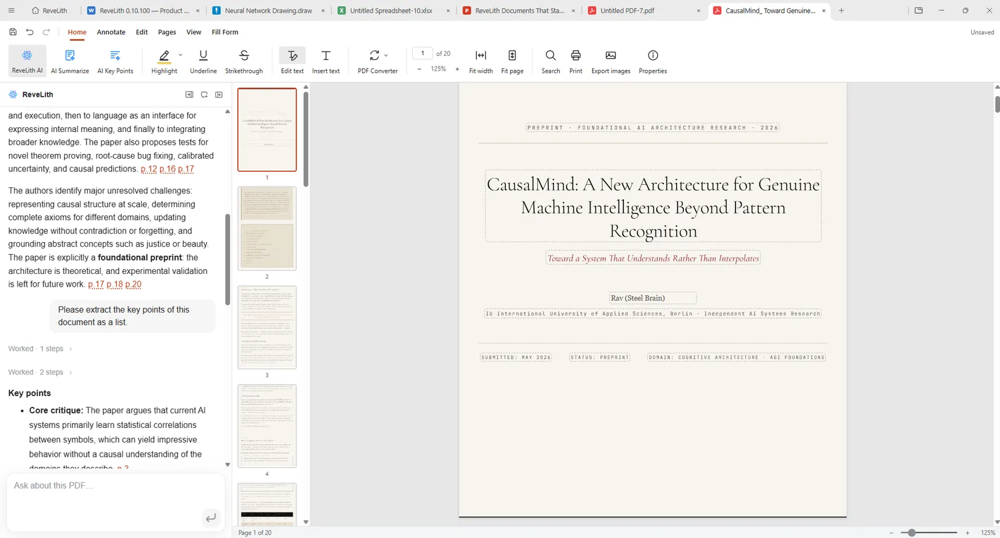
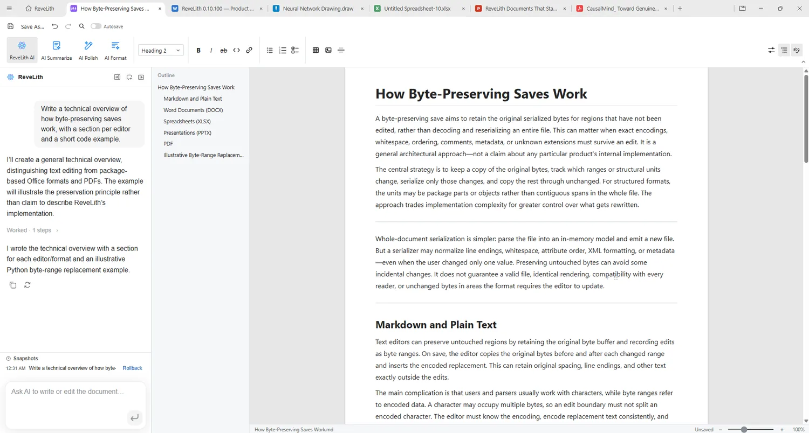
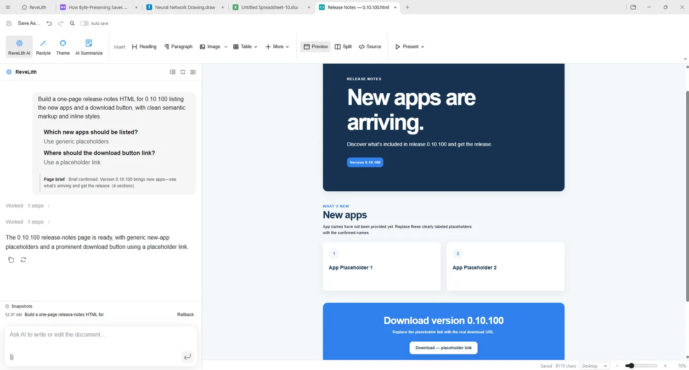
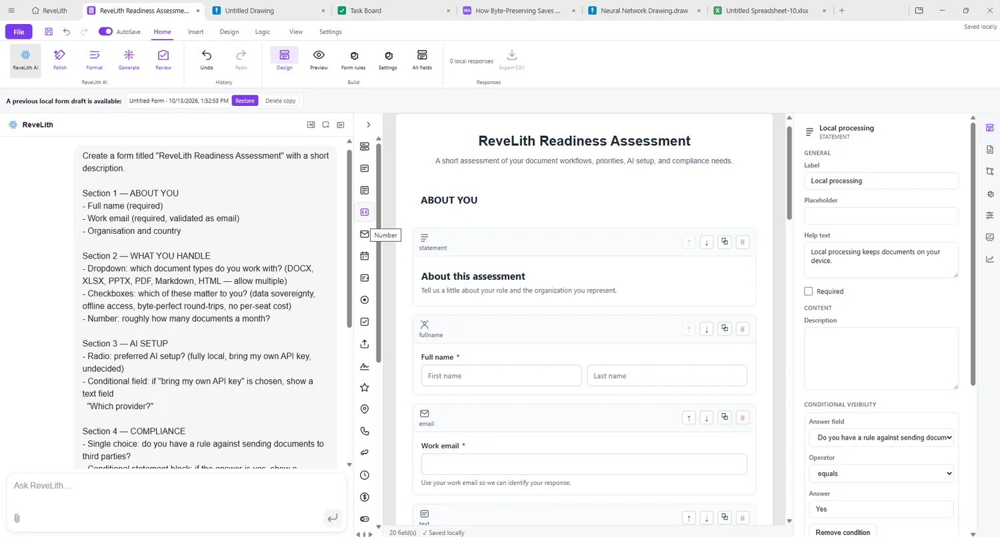
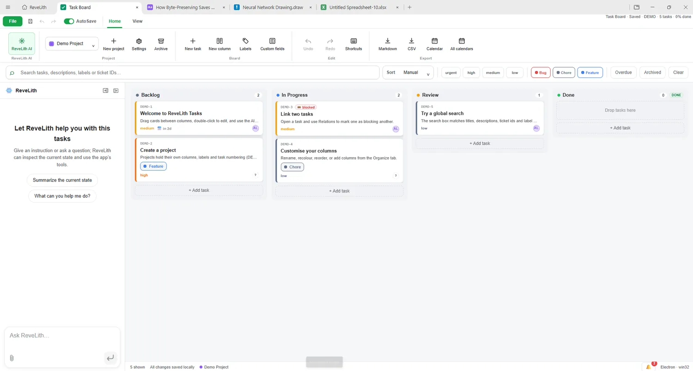
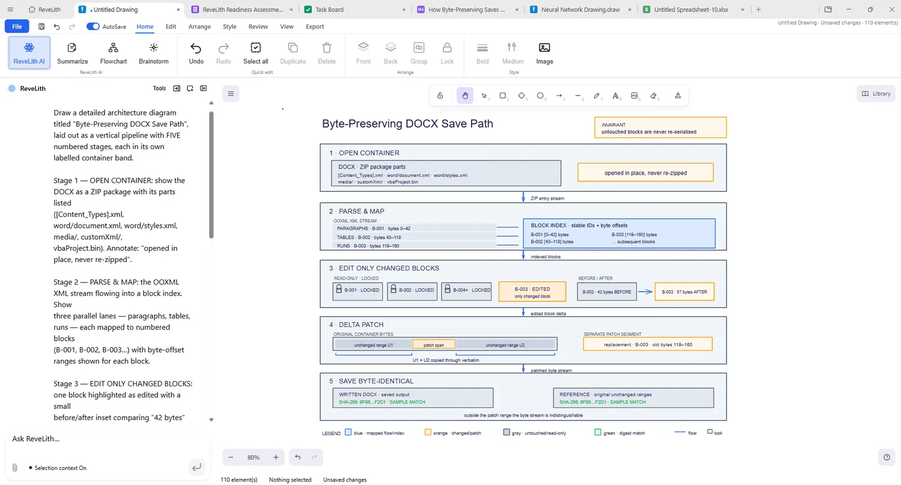

<div align="center">



# ReveLith

<p>
  <a href="https://github.com/sainibhaowal/ReveLith/releases/latest"></a>
  <a href="LICENSE"></a>
</p>

**Nine focused apps. One desktop workspace.**

Work with documents, spreadsheets, presentations, PDFs, Markdown, HTML, forms, task boards, and diagrams from one desktop workspace. Ordinary file editing happens on your computer; AI assistance is optional and uses the provider you configure.

[Download ReveLith](https://revelith.averqel.com/) · [GitHub releases](https://github.com/sainibhaowal/ReveLith/releases) · [Release notes](RELEASE_NOTES.md) · [Privacy](PRIVACY.md) · [Security](SECURITY.md)

</div>

ReveLith is organized around nine desktop modules, shown below. The Shell hosts them together; the public download website is a separate project component.

## Start here


- **Want to use ReveLith?** Download the installer for your operating system from the [official website](https://revelith.averqel.com/) or the [GitHub Releases page](https://github.com/sainibhaowal/ReveLith/releases). The release page lists the assets available for that release.
- **Want to see what's included?** Browse [Applications](#applications) and [What ReveLith is built around](#what-revelith-is-built-around).
- **Want to use AI?** Follow [Configure AI](#configure-ai).
- **Want to automate document work?** Start with [The ReveLith CLI](#the-revelith-cli) or [MCP for agents](#mcp-for-agents).
- **Want to contribute or build from source?** See [Development setup](#development-setup).
## Key Capabilities

- **Byte-Preserving Fidelity**: Edits Word (`.docx`), Excel (`.xlsx`), and PowerPoint (`.pptx`) files by patching modified structures only. Untouched elements, layouts, and styles remain 100% byte-for-byte intact.
- **Local document editing**: Ordinary document processing, editing, and supported on-device OCR run on your computer. Provider-backed AI, search, image, and media features may send the prompt or selected content to the provider you configure; see [PRIVACY.md](PRIVACY.md).
- **Native AI Copilot & BYOK**: Context-aware AI agents across all editors, supporting dedicated BYOK keys (Search, Image, Analysis) and custom local/server models (e.g. `codex-app-server`), with quote-aware prompt references and highlights.
- **Unified Workspace Shell**: Seamless tabbed multi-document management for Docs, Sheets, Slides, PDF, Markdown, and ReveLith HTML in a single cohesive environment with collapsible ribbons (`Ctrl+F1`), Global AutoSave, and multi-language UI (including Czech).
- **High-Performance Architecture**: Native Rust sidecars, WebAssembly text shaping, streaming large-deck PDF exports, and specialized parsing engines deliver instant startup and fluid performance on x64 and ARM64 hardware.
- **Modern Design System**: Polished Light, Dark, and System themes featuring Word-style dark page rendering in dark theme with accurate print, PDF export, and clipboard fidelity.

---


## Applications

All nine desktop modules are shown below. Select a screenshot to open it full-size, or select an app name to jump to its feature summary. The expandable tour below gives you a few concrete ways to try the suite.

<table>
  <tr>
    <td align="center" valign="top" width="33%">
      <a href="apps/web/public/apps/docs.webp"></a><br>
      <strong><a href="#docs">Docs</a></strong><br>
      <sub>Write and review Word documents</sub><br>
      <sub><a href="apps/web/public/apps/docs.webp">View screenshot</a></sub>
    </td>
    <td align="center" valign="top" width="33%">
      <a href="apps/web/public/apps/sheets.webp"></a><br>
      <strong><a href="#sheets">Sheets</a></strong><br>
      <sub>Explore data with formulas and charts</sub><br>
      <sub><a href="apps/web/public/apps/sheets.webp">View screenshot</a></sub>
    </td>
    <td align="center" valign="top" width="33%">
      <a href="apps/web/public/apps/slides.webp"></a><br>
      <strong><a href="#slides">Slides</a></strong><br>
      <sub>Build and refine presentations</sub><br>
      <sub><a href="apps/web/public/apps/slides.webp">View screenshot</a></sub>
    </td>
  </tr>
  <tr>
    <td align="center" valign="top" width="33%">
      <a href="apps/web/public/apps/pdf.webp"></a><br>
      <strong><a href="#pdf">PDF</a></strong><br>
      <sub>Read, annotate, and work with PDF pages</sub><br>
      <sub><a href="apps/web/public/apps/pdf.webp">View screenshot</a></sub>
    </td>
    <td align="center" valign="top" width="33%">
      <a href="apps/web/public/apps/markdown.webp"></a><br>
      <strong><a href="#markdown">Markdown</a></strong><br>
      <sub>Write with a live outline and rich tools</sub><br>
      <sub><a href="apps/web/public/apps/markdown.webp">View screenshot</a></sub>
    </td>
    <td align="center" valign="top" width="33%">
      <a href="apps/web/public/apps/html.webp"></a><br>
      <strong><a href="#html">HTML</a></strong><br>
      <sub>Edit page source beside its preview</sub><br>
      <sub><a href="apps/web/public/apps/html.webp">View screenshot</a></sub>
    </td>
  </tr>
  <tr>
    <td align="center" valign="top" width="33%">
      <a href="apps/web/public/apps/forms.webp"></a><br>
      <strong><a href="#forms-builder">Forms Builder</a></strong><br>
      <sub>Design forms for surveys and data collection</sub><br>
      <sub><a href="apps/web/public/apps/forms.webp">View screenshot</a></sub>
    </td>
    <td align="center" valign="top" width="33%">
      <a href="apps/web/public/apps/tasks.webp"></a><br>
      <strong><a href="#tasks">Tasks</a></strong><br>
      <sub>Move project work across a task board</sub><br>
      <sub><a href="apps/web/public/apps/tasks.webp">View screenshot</a></sub>
    </td>
    <td align="center" valign="top" width="33%">
      <a href="apps/web/public/apps/draw.webp"></a><br>
      <strong><a href="#ai-draw">AI Draw</a></strong><br>
      <sub>Create editable diagrams and visual work</sub><br>
      <sub><a href="apps/web/public/apps/draw.webp">View screenshot</a></sub>
    </td>
  </tr>
</table>

<details>
<summary>Explore a quick workflow tour</summary>

1. **Review a document:** open a `.docx` in Docs, make a change, then save the document or export a PDF.
2. **Explore a workbook:** open an `.xlsx`, `.csv`, or `.tsv` in Sheets. Save as `.xlsx` when you need to keep workbook formatting and structure.
3. **Collect form responses offline:** build a form, export its standalone HTML file, collect responses in a browser, then import the response package back into the matching form.
4. **Automate a file task:** use the [CLI](#the-revelith-cli) for a local conversion or inspection, or connect an agent through [MCP](#mcp-for-agents).

</details>

### Capabilities across all nine apps

Feature availability varies by file format, operating system, and provider configuration.

#### Docs

Edit Word-compatible `.docx` files in a paginated workspace. Work with tables, page layout, headers and footers, images, fields, comments, revisions, equations, lists, spellcheck, and autocorrect. Export documents to HTML, PDF, or page images.

#### Sheets

Open workbooks and delimited data. Use formulas, charts, typed CSV import and export, sorting and filters, AutoSum, cell and table formatting, clipboard image paste, and tools for working with large ranges.

#### Slides

Create and revise `.pptx` presentations with text, shapes, pictures, tables, charts, themes, and layout controls. Additional workflows include effects, right-to-left text, cross-window copy and paste, guided deck creation, and PDF export.

#### PDF

Read and organize pages, search and replace text, add annotations, use supported form fields, print selected page ranges, and convert detected tables into spreadsheet data. Supported Windows and macOS builds can use on-device OCR for scanned pages.

#### Markdown

Write in a rich editor or work with Markdown source. Use an outline, spellcheck, find and replace, mathematics, Mermaid diagrams, and Wavedrom timing diagrams. An optional round-trip mode preserves unchanged source blocks.

#### HTML

Edit page source alongside a live preview. Select elements for visual refinement, inspect and reorder the layer tree, resize content, and present a page full-screen. Export a single HTML file or produce Word and PDF output.

#### Forms Builder

Create local forms with field validation, conditional visibility, branching, calculated values, scored quizzes, themes, and authored translations. Preview forms on the device, keep drafts and responses locally, export responses as CSV or JSON, or create a standalone HTML form for offline collection and later import.

#### Tasks

Organize work in local project boards with configurable columns, labels, custom fields, priorities, dates, dependencies, sub-tasks, comments, attachments, saved views, search, and activity history. Export boards or projects to Markdown, CSV, JSON, and iCalendar.

#### AI Draw

Build diagrams and illustrations on a drawing canvas with editable shapes, supported SVG artwork, grouping and layout tools, annotations, hatch fills, and isometric, dimetric, or perspective projections. Save board files and export PNG or SVG; prompt-based image generation requires a compatible configured provider.

### File formats at a glance

This table lists the primary document formats exposed by the apps. Importing a format does not guarantee that every feature from the software that created it will be preserved; keep a copy of important files and review exports.

| App           | Open or import                                                        | Save or export                                                    | Notes                                                                                                           |
| ------------- | --------------------------------------------------------------------- | ----------------------------------------------------------------- | --------------------------------------------------------------------------------------------------------------- |
| Docs          | `.docx`                                                               | `.docx`, PDF, HTML, page images                                   | Word-compatible document editing.                                                                               |
| Sheets        | `.xlsx`, `.xlsm`, `.xls`, `.csv`, `.tsv`                              | `.xlsx` or `.xlsm` workbooks, CSV, PDF                            | CSV and TSV are plain tabular data; use a workbook format for workbook structure and formatting.                |
| Slides        | `.pptx`                                                               | `.pptx`, PDF, PNG                                                 | Legacy binary `.ppt` files are not supported; save them as `.pptx` in another presentation app first.           |
| PDF           | `.pdf`                                                                | `.pdf`                                                            | Read, annotate, organize, merge, split, redact, and extract detected tables into spreadsheet data.              |
| Markdown      | `.md`, `.markdown`                                                    | Markdown, DOCX, PDF, page images                                  | Export options depend on the selected workflow.                                                                 |
| HTML          | `.html`, `.htm`                                                       | Single-file HTML, DOCX, PDF                                       | Single-file export embeds supported local images.                                                               |
| Forms Builder | `.form.json`                                                          | `.form.json`, standalone HTML, response CSV/JSON                  | The standalone form keeps responses in the respondent's browser; responses are imported into the matching form. |
| Tasks         | `.tasks`; import CSV or Trello board exports                          | `.tasks`, shareable HTML, Markdown, CSV, JSON, iCalendar (`.ics`) | Boards are stored locally; exports can be shared as files.                                                      |
| AI Draw       | `.draw`; legacy `.drawboard`, `.whiteboard`, and supported board JSON | `.draw`, PNG, SVG                                                 | Drawings are editable board files; image exports are not editable board documents.                              |

### Shared desktop workspace

- **ReveLith Shell:** hosts all nine modules with tabs, recent and starred files, local folders, shared settings, and file open/save flows.
- **Shared Chat:** streams responses, supports cancellation and clarification, and can use tools, attachments, or media when the configured provider supports them. Provider-backed actions may send the prompt and relevant selected content to that provider.
- **Public website:** `apps/web` publishes downloads and product information; it is separate from the nine desktop modules. `apps/app-chat` supplies shared Chat UI, while `apps/shell` is the desktop host.

## What ReveLith is built around

### Work with files on your computer

ReveLith's editors open and save files on your device. Document rendering, editing, and supported OCR do not require an AI service. File fidelity is format-specific: the editors aim to preserve untouched structures where their file engine supports it, but complex or unsupported content may not round-trip identically. Keep a backup when editing important files, especially when a document relies on specialized features from another application.

### Choose whether and where AI runs

AI is an optional layer over the editors, not a requirement for ordinary local editing. Configure a compatible provider and model in Settings. Text generation, web search, image generation, and media analysis may have separate provider settings. A local endpoint can be configured where the provider supports it.

When you send an AI request, the prompt and the context needed for that request may be sent to the configured provider. That context can include selected text, excerpts from files, attachments, images, audio, video, or other material you explicitly ask the AI to process. The provider's own data handling rules apply. Do not send material to a provider unless its terms and privacy practices are suitable for that material.

### Clear privacy controls

- **Editing:** ordinary file reading, editing, and saving happen locally.
- **AI:** network requests occur when you invoke a provider-backed AI, search, image, or media feature. Review the configured provider before sending sensitive material.
- **OCR:** supported Windows and macOS builds can process scanned PDF pages using operating-system OCR on the device.
- **Usage analytics:** official packaged builds send anonymous product-usage events by default. You can turn this off in **Settings → General**. Events include technical app/session details and file extensions, not document content, file names, or paths. Source builds and forks without official analytics configuration do not send these events. See [PRIVACY.md](PRIVACY.md) for the complete event and data description.

ReveLith does not describe every AI feature as local: whether a request stays on-device depends on the provider and endpoint you configure.

## Install and update

Download ReveLith from the [official website](https://revelith.averqel.com/) or choose a file directly from [GitHub Releases](https://github.com/sainibhaowal/ReveLith/releases). The website links to the selected release's installer assets. The files published for a release are the source of truth: names, formats, and architectures can change between releases.

### System requirements

- **Windows:** Windows 10 or later; choose the x64 or ARM64 installer that matches your computer. See [Electron's platform requirements](https://www.electronjs.org/docs/latest/breaking-changes).
- **macOS:** macOS 12 Monterey or later for the current desktop build. Newer Electron versions can raise this minimum; check the release notes when upgrading. See [Electron's platform changes](https://www.electronjs.org/docs/latest/breaking-changes).
- **Linux:** 64-bit x64 or ARM64 distribution with the runtime libraries required by Electron. Choose an AppImage or the matching DEB/RPM package when that asset is published.

The release workflow builds Windows x64/ARM64, Linux x64/ARM64, and macOS x64/Apple silicon packages. Not every release necessarily publishes every build. ReveLith's installer includes the desktop runtime; Node.js and Rust are development prerequisites, not requirements for using an installed release.

### Install for the first time

1. Open the [download page](https://revelith.averqel.com/) and select the installer for your operating system and processor architecture. If you are unsure which architecture you have, use the standard x64 download on Intel/AMD PCs and the ARM64 or Apple silicon download on ARM devices when available.
2. **Windows:** run the downloaded Setup `.exe` and follow the installer. **macOS:** open the `.dmg` and move ReveLith to Applications. **Linux:** use the AppImage, or install the listed `.deb` or `.rpm` package with your distribution's package manager.
3. Launch ReveLith, open an existing supported file or choose an app to create one. Ordinary editing works without AI setup; configure a provider later only if you want AI features.

To update, download and install the newer release for the same platform. On Linux, follow the package format's usual update process. See the [release notes](RELEASE_NOTES.md) for changes and the release page for the exact assets available.

## Configure AI

1. Open **Settings → AI & Models** and select a provider and model for text requests.
2. Add the API key or endpoint details required by that provider. Keys are kept in the local application settings store; never commit real keys to this repository.
3. If you use search, image generation, or media analysis, configure their provider settings separately where available.
4. Try a non-sensitive prompt first. For provider-backed requests, ReveLith sends the necessary prompt and context to the selected provider.

Forms Builder and AI Draw restrict selected-content Ask AI to a same-device loopback provider. Tasks Ask AI uses the provider configured in ReveLith after you explicitly choose the selected-task action. Regular chat and other AI actions follow the configured provider and the context shown by the feature.

AI features may be unavailable until the required provider, model, or capability is configured. Local document editing remains available without AI setup.

## The ReveLith CLI

The `revelith` command provides document inspection, conversion, creation, structured editing, rendering, and format-specific checks and audits. Use `revelith --help` for the commands available in your installed build.

```sh
# Inspect a Word document
revelith info report.docx

# Check a Word document
revelith docs check report.docx

# Check a workbook
revelith sheet check budget.xlsx

# Audit slide geometry
revelith slides audit presentation.pptx

# Convert a Word document to PDF
revelith convert report.docx --to pdf --out report.pdf

# Create a Word document from Markdown
revelith create --type docx --from notes.md --out report.docx

# Read a PDF page
revelith pdf read report.pdf --page 1

# Open a slide deck at slide 3 (slide indexes are zero-based)
revelith open presentation.pptx --slide 3
```

If the CLI is bundled with your installation but is not on your `PATH`, run `revelith install-cli` and follow its instructions. The CLI uses the local ReveLith document engines. AI-related commands use the provider settings configured for ReveLith and may make network requests.

## MCP for agents

ReveLith can expose document tools to compatible agents through MCP:

```sh
# Local MCP connection over stdio
revelith mcp

# Streamable HTTP connection with a bearer token
revelith mcp --http 3930 --token YOUR_SECRET_TOKEN
```

Depending on the mode and tool, agents can inspect files, read PDF text, edit documents, update spreadsheet cells, build presentations, and exchange files. HTTP mode can transfer files; treat its token like a credential and do not expose an unauthenticated server to a public network. Use `revelith mcp --help` for options supported by your build.

For safe structured edits, inspect the file first, read the relevant `revelith guide <domain>`, and use `--dry-run` where supported. Review the output before replacing an original file.

## Development setup

### Requirements

- Node.js **22.12 or later**
- npm **10 or later**
- Rust and Cargo on `PATH` for native spreadsheet components and related build tasks
- Platform build tools for the operating system you package on

### Install and run

```sh
git clone https://github.com/sainibhaowal/ReveLith.git
cd ReveLith
npm ci
npm run fixtures
npm run dev
```

The root `npm run dev` command starts the ReveLith Shell with development renderer servers for Docs, Sheets, Slides, PDF, Markdown, Forms Builder, Tasks, and AI Draw. Run the HTML module separately with `npm run dev -w @revelith/html`. To launch the focused Docs entry, use `npm run dev:docs`.

### Checks

```sh
npm run typecheck
npm run lint
npm run format:check
npm test
```

For the repository's combined pre-commit validation, run:

```sh
npm run precommit:check
```

Some checks build native components or take longer than a single-app test. Run the command and review its complete result; this README does not imply that a particular checkout has passed them.

### Build and package
Build the app modules and desktop shell with `npm run build:all`. Create a local installer on its supported build platform:
Build the app modules and desktop shell with `npm run build:all`. Create a local installer on its supported build platform:

- Windows: `npm run dist:win`
- macOS: `npm run dist:mac`
- Linux: `npm run dist:linux`

Release automation builds the platform and architecture combinations declared in `.github/workflows/release.yml`. Native packages must be built with the required platform toolchains and sidecars; use the release workflow when you need the official multi-platform asset set.

## Repository map

| Path                                                                                           | Purpose                                                                      |
| ---------------------------------------------------------------------------------------------- | ---------------------------------------------------------------------------- |
| `apps/shell`                                                                                   | Desktop host, tabs, file launch/save flows, shared settings, and packaging.  |
| `apps/docs`, `apps/sheets`, `apps/slides`, `apps/pdf`, `apps/markdown`, `apps/html`            | The document and content editors.                                            |
| `apps/forms-builder`, `apps/tasks`, `apps/whiteboard`                                          | Forms, task management, and the AI Draw module hosted in the shell.          |
| `apps/app-chat`                                                                                | Shared chat and attachment UI used by integrated modules.                    |
| `apps/web`                                                                                     | The public download and product website.                                     |
| `packages/docx-engine`, `packages/pptx-engine`, `packages/xlsx-gateway`, `packages/file-parse` | Document, presentation, spreadsheet, and file-reading engines.               |
| `packages/ai-provider`, `packages/agent-core`, `packages/ai-search`                            | Provider configuration, agent/tool execution, and search/media integrations. |
| `packages/revelith-cli`                                                                        | CLI and MCP entry points for document workflows.                             |
| `docs`, `skills`                                                                               | Product guides, development notes, and agent skill resources.                |

For the implementation-focused feature catalog, see [docs/FEATURES_END_TO_END_GUIDE.md](docs/FEATURES_END_TO_END_GUIDE.md). For module-specific setup, see [apps/README.md](apps/README.md).

## Security and support

- For a suspected vulnerability, use the process in [SECURITY.md](SECURITY.md) rather than posting exploit details in a public issue.
- For bugs and feature requests, open an issue in the [GitHub repository](https://github.com/sainibhaowal/ReveLith/issues) with the app, operating system, steps to reproduce, and—if possible—a small non-sensitive sample file.
- For AI or provider behavior, include the provider/model and the exact feature used, but remove API keys, personal data, and confidential document contents.

## License

ReveLith's code is licensed under the [Apache License 2.0](LICENSE). Bundled third-party components and fonts may have additional terms; see [NOTICE](NOTICE), [LICENSE-UNICODE.txt](LICENSE-UNICODE.txt), and the [font license notes](apps/docs/src/renderer/fonts/README.md).
